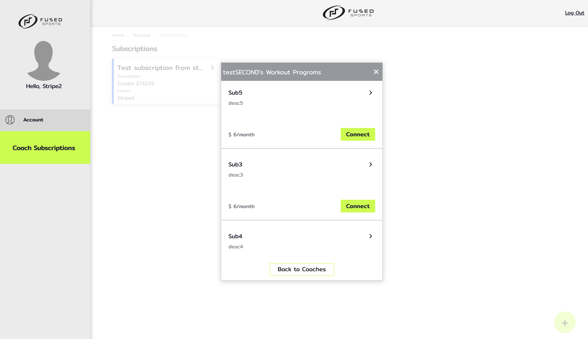
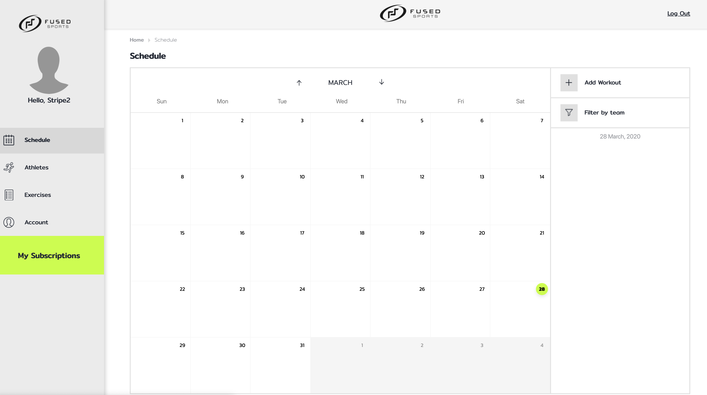

<!-- generated:portfolio-cover -->
# **My Portfolio**

## **Kirill Kohan**

**Senior Software Engineer / Tech Lead (Frontend and Mobile)**

kiril.kohan@gmail.com
<!-- /generated:portfolio-cover -->

Senior software engineer and tech lead with 7+ years of experience building web, mobile and desktop applications with React, React Native, Node.js and TypeScript. <!-- src: calc:years_experience, profile, syspro-saas-erp#1, general-motors-navigation#1, velas-wallet#1, itjet-fintech#1 --> The projects in this portfolio range from a schema-driven ERP web platform, a vehicle companion app with HERE maps and a generative AI design app for Jira to a clinical trial patient app, an IoT dosimeter app, a smart-home app, a multi-network crypto wallet and client apps for fintech, fitness and social products. <!-- src: syspro-saas-erp#1, general-motors-navigation#1, designai-jira-plugin#1, orion-mobile-clinical-ink#1, thermo-fisher-dosimeter#1, omo-systems-smart-home#1, velas-wallet#1, itjet-fintech#1 --> The work spans hands-on frontend and mobile engineering, software architecture and leading teams of up to 8 engineers. <!-- src: syspro-saas-erp#3, general-motors-navigation#3, thermo-fisher-dosimeter#3, calc:team_size_led -->

<!-- project: syspro-saas-erp -->

<!-- generated:project-syspro-saas-erp -->
## **Schema-driven ERP web platform (React 19, TypeScript)**

### **SYSPRO | Senior Software Engineer**
<!-- /generated:project-syspro-saas-erp -->

SYSPRO is bringing its ERP product to the web with a schema-driven platform: every ERP program's form, grid and toolbar is stored as a declarative definition, and a single React runtime renders whichever definition it receives when a user opens that program. <!-- src: syspro-saas-erp#1 --> ERP operators work with programs such as Bill of Materials, Accounts Payable and Inventory in the browser, with live forms and search grids, navigation between related programs, overlays and single sign-on through OpenID Connect (OIDC). <!-- src: syspro-saas-erp#1, syspro-saas-erp#2 -->

<!-- generated:media-syspro-saas-erp -->

<!-- /generated:media-syspro-saas-erp -->

**Responsibilities**

* Delivered the frontend through architecture-governed specification-driven development (SDD), not ad-hoc AI code generation, and helped define the process: the specification templates, the validation routine and the rules for AI coding agents. AI agents implemented and reviewed code against each component's specification under human review, which reduced pull request review cycles. <!-- src: syspro-saas-erp#4.2, syspro-architecture-scope, syspro-review-cycles -->
* Worked with the lead architect on the platform and solution architecture, co-authoring architecture documents and driving open questions to decisions. Owned the frontend technology stack of the Login micro-frontend and the schema-driven runtime, adding the OIDC libraries and recommending Vitest Browser Mode for component tests. <!-- src: syspro-saas-erp#4.3, syspro-architecture-scope, syspro-tech-stack-ownership -->
* Built core modules of the React 19 and TypeScript runtime that turns view definitions into live ERP screens: metadata-driven KendoReact handlers for forms, search grids and lookup fields, and view orchestration with XState and Zustand. The runtime cut the time to bring an ERP screen to the web from days to hours. <!-- src: syspro-saas-erp#4.1, syspro-saas-erp#4.4, syspro-saas-erp#4.5, syspro-speed -->
* Built the Login micro-frontend from scratch with Vite, React 19, TanStack Router and Storybook, with typography fixed to meet WCAG 1.4.4, and set up OpenID Connect so this separately hosted identity app is the only part of the system that ever sees a user's password. <!-- src: syspro-saas-erp#4.6, syspro-saas-erp#4.7 -->

**Technologies and frameworks**

React 19, TypeScript, Vite, KendoReact, TanStack Router, Zustand, XState, oidc-client-ts, OpenTelemetry, Storybook, Vitest, Playwright, Node.js, Azure DevOps. <!-- src: syspro-saas-erp#5 -->

<!-- project: designai-jira-plugin -->

<!-- generated:project-designai-jira-plugin -->
## **Generative AI design app for Jira (Atlassian Forge, React)**

### **Generative AI Jira Plugin | Frontend Engineer**
<!-- /generated:project-designai-jira-plugin -->

An Atlassian Forge app for Jira, part of a generative AI design product, that lets a user start AI design generation directly from a Jira issue. <!-- src: designai-jira-plugin#1 --> A panel on the issue holds a form with 7 kinds of input, from a design description and reference images to a product requirements document (PRD), a Model Context Protocol (MCP) server URL and a design system. <!-- src: designai-jira-plugin#2, designai-jira-plugin#7 --> The plugin hands this context to the design-generation pipeline and tracks the generated design in an automatically created Jira subtask. <!-- src: designai-jira-plugin#1, designai-jira-plugin#2 -->

<!-- generated:media-designai-jira-plugin -->

<!-- /generated:media-designai-jira-plugin -->

**Responsibilities**

* Built the plugin from scratch and owned it. Moved it from Forge UI Kit to Forge Custom UI, a React and TypeScript app rendered inside Jira, and converted the resolver to TypeScript on Node.js with a shared error utility. <!-- src: designai-jira-plugin#3, designai-jira-plugin#4.1 -->
* Built the design generation form with Atlaskit components: description and website URL fields, image upload with preview, PRD and user-flow uploads on a reusable file-upload component, an MCP server URL input and design system selection, with validation in both the UI and the resolver. <!-- src: designai-jira-plugin#4.2, designai-jira-plugin#2 -->
* Moved file handling off the backend: Forge limits the size of image uploads, so images now go straight from the plugin to Azure Blob Storage, and uploading the configuration file there starts design generation. The plugin no longer depends on the backend, and larger images can be uploaded. <!-- src: designai-jira-plugin#4.3 -->
* Added ESLint with the Atlaskit design-system plugin, TypeScript checks, a pre-commit hook and Atlassian design tokens, and wrote the README and deployment guide. <!-- src: designai-jira-plugin#4.4, designai-jira-plugin#3 -->

**Technologies and frameworks**

React, TypeScript, Atlassian Forge (UI Kit, Custom UI, resolvers), Jira API, Atlaskit (Atlassian Design System), Node.js 22, Azure Blob Storage, ESLint, SonarQube. <!-- src: designai-jira-plugin#5 -->

<!-- project: general-motors-navigation/companion -->

<!-- generated:project-general-motors-navigation/companion -->
## **Vehicle companion app with HERE maps (React Native)**

### **General Motors | Team Leader**
<!-- /generated:project-general-motors-navigation/companion -->

A vehicle companion app for General Motors owners: from their phone, drivers control and check their car, for example by starting the engine remotely or checking tire pressure, for gas and electric vehicles across the Chevrolet, Buick, GMC and Cadillac brands. <!-- src: general-motors-navigation#1, general-motors-navigation#2 --> Inside it, a reusable map feature with map display, search, a bottom drawer, markers and EV charging stations ships as a React Native micro-frontend built on the HERE SDK and is reused by several company products. <!-- src: general-motors-navigation#1 -->

<!-- generated:media-general-motors-navigation/companion -->

<!-- /generated:media-general-motors-navigation/companion -->

**Responsibilities**

* As Team Leader, led the map team of 8 developers (6 React Native, 1 iOS, 1 Android) and coordinated its work with the UI team, the backend teams and the HERE SDK vendor: set scope, priorities and deadlines, ran code reviews and mentored developers. After release, user engagement rose 20% and app crashes fell 15%. <!-- src: general-motors-navigation#4.1, general-motors-navigation#4.2, general-motors-navigation#3 -->
* Led development of the reusable HERE SDK map library, packaged as a React Native micro-frontend and integrated into several company products, and owned the system design of the app's modular architecture, so new feature requests could be added without reworking existing modules. <!-- src: general-motors-navigation#4.3, general-motors-navigation#4.4 -->
* Created and documented the delivery and testing process for the map feature's three-level chain of host app, feature app and map provider app, then planned the move of the feature app into the host app with clean architecture and domain-driven design. Fixed multi-map bugs by giving each map instance its own reference and event listener. <!-- src: general-motors-navigation#4.9, general-motors-navigation#4.10, general-motors-navigation#4.11 -->
* Defined the unit-testing strategy and introduced an Agile delivery process: unit-test coverage reached 95%, and production bugs fell by 50%. <!-- src: general-motors-navigation#4.5 -->

**Technologies and frameworks**

TypeScript, React Native, HERE SDK, HERE API, React Native micro-frontends, Redux Toolkit, Redux Saga, RxJS, Storybook, Jest, Detox, BrowserStack, Fastlane, Bitrise, Bugsnag, Kibana. <!-- src: general-motors-navigation#5 -->

<!-- project: general-motors-navigation/navigation -->

<!-- generated:project-general-motors-navigation/navigation -->
## **In-car navigation app on HERE (React Native, React, Node.js)**

### **General Motors | Team Leader**
<!-- /generated:project-general-motors-navigation/navigation -->

In-car navigation for General Motors, built on the HERE SDK, with features that guide the driver in the car, including route-deviation handling and search. <!-- src: general-motors-navigation#1, general-motors-navigation#2 --> The work also covered a voice-driven navigation proof of concept and a passenger second-screen feature for a luxury car brand. <!-- src: general-motors-navigation#1, general-motors-navigation#4.7 -->

<!-- generated:media-general-motors-navigation/navigation -->

<!-- /generated:media-general-motors-navigation/navigation -->

**Responsibilities**

* Implemented in-car navigation features with the HERE HNav and HNod SDK and HERE service packages, including route-deviation handling and a redesigned search UI. <!-- src: general-motors-navigation#4.6, general-motors-navigation#7 -->
* Built a proof of concept for in-car navigation that combined search, routing, guidance and a voice AI assistant able to build routes and find places from spoken requests. <!-- src: general-motors-navigation#4.7 -->
* Implemented a passenger second-screen feature for a luxury car brand. <!-- src: general-motors-navigation#4.8 -->

**Technologies and frameworks**

TypeScript, React Native, HERE HNav / HNod SDK, HERE API, Node.js, voice AI assistant. <!-- src: general-motors-navigation#5 -->

<!-- project: velas-wallet -->

<!-- generated:project-velas-wallet -->
## **Velas crypto wallet (React, React Native, Electron)**

### **Velas | Technical Leader**
<!-- /generated:project-velas-wallet -->

An open-source, non-custodial, multi-language crypto wallet for the Velas, Ethereum, BNB Smart Chain (BSC), Heco and Bitcoin networks, available on the web, on mobile and as a desktop app for macOS, Linux and Windows. <!-- src: velas-wallet#1 --> Users stake VLX and earn staking rewards, manage tokens and assets, swap tokens between networks through bridges, and send and receive crypto by QR code. <!-- src: velas-wallet#2 -->

<!-- generated:media-velas-wallet -->

<!-- /generated:media-velas-wallet -->

**Responsibilities**

* As Technical Leader, developed the wallet for web, mobile and desktop with React, React Native, TypeScript, MobX and Web3.js, and built a new cross-platform wallet in React Native Web from scratch, including the architecture for managing tokens and assets. <!-- src: velas-wallet#3, velas-wallet#4.1, velas-wallet#4.8 -->
* Cut the staking page's loading time from 2 minutes to 5 seconds by moving the staking list's filtering to the server and adding a Node RPC fallback, and redesigned the staking-rewards calculation on the Node.js backend, after which user engagement grew 4x. <!-- src: velas-wallet#4.2, velas-wallet#4.6 -->
* Set up GitHub Actions workflows that build, sign and release the desktop app on macOS, Linux and Windows and the mobile app, and published the app on F-Droid and the Snapcraft store, after which the number of new users tripled. <!-- src: velas-wallet#4.4, velas-wallet#4.5 -->
* Made the first interaction with the Android wallet 3x faster by caching and optimizing wallet and account creation, and added automatic Web3 provider failover that switches to another provider when the active one is slow or unreachable. <!-- src: velas-wallet#4.9, velas-wallet#4.3 -->

**Technologies and frameworks**

TypeScript, JavaScript, React, React Native, React Native Web, Electron, MobX, Web3.js, Node.js, Detox, Jest, GitHub Actions. <!-- src: velas-wallet#5 -->

<!-- project: orion-mobile-clinical-ink -->

<!-- generated:project-orion-mobile-clinical-ink -->
## **Clinical trial patient app (React Native, Android)**

### **Clinical Trials Patient App | Senior React Native Engineer**
<!-- /generated:project-orion-mobile-clinical-ink -->

A patient-facing mobile app for clinical trials (eCOA, electronic clinical outcome assessment): study participants use it to complete trial tasks and questionnaires, view study content and join video visits with their clinic. <!-- src: orion-mobile-clinical-ink#1 --> Its main features include a dynamic questionnaire engine, task scheduling, a study library and offline-first sync that uploads answers and files later. <!-- src: orion-mobile-clinical-ink#2 --> The product has two code bases: a React Native app built with Expo and a long-running native Android app in Java and Kotlin. <!-- src: orion-mobile-clinical-ink#1 -->

<!-- generated:media-orion-mobile-clinical-ink -->

<!-- /generated:media-orion-mobile-clinical-ink -->

**Responsibilities**

* Worked on both code bases: refactoring, layout and bug fixing in the React Native app, and platform maintenance and releases in the native Android app. <!-- src: orion-mobile-clinical-ink#3, orion-mobile-clinical-ink#4.1 -->
* Rebuilt the legacy study library flow, the largest feature in the React Native app, as a TypeScript documents screen made of small components, moved its utilities to TypeScript and rewired navigation and the study reducer, adding about 1,000 lines of unit and screen tests. <!-- src: orion-mobile-clinical-ink#4.2 -->
* Replaced React Native's built-in safe-area view with react-native-safe-area-context across the app and added an ESLint rule so new code must use the new import. This fixed layout overlaps on iOS and Android, such as document titles under the status-bar icons. <!-- src: orion-mobile-clinical-ink#4.3 -->
* Migrated the native Android app to Android 14 (SDK 34) with Java 17 and handled its behavior changes, fixed the regressions that followed, including a login crash traced to the Jackson version, rotated the pinned SSL certificates and upgraded SQLCipher to meet Google Play requirements. <!-- src: orion-mobile-clinical-ink#4.4, orion-mobile-clinical-ink#4.5 -->

**Technologies and frameworks**

React Native, Expo, TypeScript, Redux Toolkit, Redux Saga, Apollo Client, GraphQL, AWS Amplify, Jest, React Native Testing Library, ESLint, Java, Kotlin, Gradle, SQLCipher, Jenkins. <!-- src: orion-mobile-clinical-ink#5 -->

<!-- project: omo-systems-smart-home -->

<!-- generated:project-omo-systems-smart-home -->
## **Smart-home IoT app (React Native)**

### **OMO Systems | Team Leader**
<!-- /generated:project-omo-systems-smart-home -->

A smart-home app for residents of multi-apartment buildings, sold in several countries, that combines access control, security and home automation for the whole building and each apartment. <!-- src: omo-systems-smart-home#1 --> Residents open entrances, doors, barriers, elevators, gates and waste bins from the app, watch live cameras and video archives synced with motion sensors, protect the apartment with door and window sensors and automatic gas and water shut-off on leaks, set up automation scenarios and share the home with family members. <!-- src: omo-systems-smart-home#2 --> Paid features are unlocked by a monthly subscription. <!-- src: omo-systems-smart-home#1, omo-systems-smart-home#2 -->

<!-- generated:media-omo-systems-smart-home -->

<!-- /generated:media-omo-systems-smart-home -->

**Responsibilities**

* As Team Leader in the R&D department, led and mentored a team of about 3 engineers: ran code reviews, set coding standards and onboarded new engineers, which raised team efficiency by 20%. <!-- src: omo-systems-smart-home#4.5, omo-systems-smart-home#3 -->
* Delivered the core React Native app for controlling the smart-home IoT devices, and fixed video stream issues by patching the react-native-vlcplayer video player library. <!-- src: omo-systems-smart-home#4.1, omo-systems-smart-home#4.6 -->
* As feature owner of subscription billing, built an automated monthly payment flow: a React single-page app built from scratch and shown in a web view inside the mobile app, with a payment gate that blocks devices and features for users who haven't paid. Company income grew 10x after launch. <!-- src: omo-systems-smart-home#4.3, omo-systems-smart-home#3 -->
* Fixed insecure face-recognition unlock on specific Android devices by patching a native Android biometrics library into react-native-keychain, for face and fingerprint login on Samsung devices. <!-- src: omo-systems-smart-home#4.4 -->

**Technologies and frameworks**

TypeScript, React Native, React, react-native-webview, React Navigation, Wix React Native Navigation, Redux, Reselect, Redux Saga, react-native-keychain, react-native-vlcplayer, native Android biometrics, Fastlane. <!-- src: omo-systems-smart-home#5 -->

<!-- project: thermo-fisher-dosimeter -->

<!-- generated:project-thermo-fisher-dosimeter -->
## **IoT dosimeter app (React Native)**

### **Thermo Fisher Scientific | Software Engineer**
<!-- /generated:project-thermo-fisher-dosimeter -->

An IoT healthcare app for iOS and Android that helps medical staff who work with radiation track their dose and prevent overexposure. <!-- src: thermo-fisher-dosimeter#1 --> The app reads radiation dosimeters over Bluetooth, stores their data offline-first in a Realm database and sends it to an IoT server over MQTT. <!-- src: thermo-fisher-dosimeter#1 --> It has three roles (user, admin and superuser), syncs many dosimeters at once with the progress, errors and time of each sync, keeps a local sync history filterable by date range, wearer, errors and ID, updates dosimeter firmware, and keeps secure values in the device keychain. <!-- src: thermo-fisher-dosimeter#2 -->

<!-- generated:media-thermo-fisher-dosimeter -->

<!-- /generated:media-thermo-fisher-dosimeter -->

**Responsibilities**

* Built the app from scratch as a software engineer and designed its overall architecture with React Native, TypeScript, Redux and an offline-first Realm database, including the API layer between the screens and the backend over REST, MQTT and Bluetooth. <!-- src: thermo-fisher-dosimeter#4.1, thermo-fisher-dosimeter#3 -->
* Rewrote legacy native iOS and Android libraries to use MQTT over TLS with client certificates, which made data transfer 30% faster, and built dosimeter firmware updates that run as cross-platform background jobs on Android and iOS. <!-- src: thermo-fisher-dosimeter#4.2, thermo-fisher-dosimeter#4.4 -->
* Built the sync flow that reads many dosimeters at the same time, and improved the accuracy of Bluetooth Low Energy (BLE) communication on react-native-ble-plx by reworking the buffer-reading logic and the data parsing, so dosimeter data is no longer overwritten. <!-- src: thermo-fisher-dosimeter#4.8, thermo-fisher-dosimeter#4.3 -->
* Implemented a secure login flow with OAuth 2.0 and, as part of a team-wide performance effort, optimized rendering and offline data access in Realm, which made the app 20% faster. <!-- src: thermo-fisher-dosimeter#4.5, thermo-fisher-dosimeter#4.6 -->

**Technologies and frameworks**

TypeScript, React Native, native iOS and Android libraries, Redux, Redux Saga, React Navigation, Realm, Bluetooth Low Energy (BLE), react-native-ble-plx, MQTT over TLS, OAuth 2.0, react-native-app-auth, react-native-keychain, Formik, AsyncStorage, react-native-fs, REST API. <!-- src: thermo-fisher-dosimeter#5 -->

<!-- project: itjet-fintech/aspiration-signup -->

<!-- generated:project-itjet-fintech/aspiration-signup -->
## **Aspiration signup flow (React Native Web)**

### **Aspiration, an Itjet client | Full-Stack Engineer**
<!-- /generated:project-itjet-fintech/aspiration-signup -->

Aspiration is a US eco-focused bank and fintech product (Forbes top 10). <!-- src: itjet-fintech#1, itjet-fintech#7 --> Its signup flow, built in React Native Web, is shared by the native mobile apps and the web app, with bank-account linking through Plaid, address autocomplete through Google Places and bot protection through reCAPTCHA v3. <!-- src: itjet-fintech#1, itjet-fintech#2 -->

<!-- generated:media-itjet-fintech/aspiration-signup -->

<!-- /generated:media-itjet-fintech/aspiration-signup -->

**Responsibilities**

* Built the reusable React Native Web signup flow shared by Aspiration's native mobile and web apps, working with the client's native mobile developers on integrating it into the native apps. Building new flows became 3x faster. <!-- src: itjet-fintech#4.1, itjet-fintech#3 -->
* Integrated Plaid, Google Places and reCAPTCHA v3 into the signup flow and added new signup screens and components. <!-- src: itjet-fintech#4.11 -->
* Introduced TypeScript and built an Atomic Design component library (design system) with automated tests in Puppeteer, Jest and Cucumber, which doubled delivery speed. <!-- src: itjet-fintech#4.3, itjet-fintech#7 -->
* Integrated A/B testing so the marketing team could analyze user engagement, and wrote a pull request style guide and onboarding documentation and built a utility for end-to-end tests. <!-- src: itjet-fintech#4.2, itjet-fintech#4.12 -->

**Technologies and frameworks**

TypeScript, React Native Web, React Navigation, Apollo Client (GraphQL), Plaid, Google Places API, reCAPTCHA v3, PlanOut A/B testing, Storybook, Puppeteer, Jest, Cucumber. <!-- src: itjet-fintech#5 -->

<!-- project: itjet-fintech/aspiration-web -->

<!-- generated:project-itjet-fintech/aspiration-web -->
## **Aspiration banking web app (React, Next.js)**

### **Aspiration, an Itjet client | Full-Stack Engineer**
<!-- /generated:project-itjet-fintech/aspiration-web -->

Aspiration is a US eco-focused bank and fintech product (Forbes top 10). <!-- src: itjet-fintech#1, itjet-fintech#7 --> Its new React web app holds the banking flows for planting trees from transactions and for profile and settings. <!-- src: itjet-fintech#1, itjet-fintech#2 -->

<!-- generated:media-itjet-fintech/aspiration-web -->

<!-- /generated:media-itjet-fintech/aspiration-web -->

**Responsibilities**

* Built a new React web flow from scratch from the designs, mobile-first, with reusable components following Atomic Design. <!-- src: itjet-fintech#4.13 -->
* Added a scaffolding generator (Plop) that creates the file structure for new components. <!-- src: itjet-fintech#4.13 -->
* Built web features with Next.js and server-side rendering and used GraphQL. <!-- src: itjet-fintech#4.7 -->

**Technologies and frameworks**

React, Next.js, server-side rendering, GraphQL, Apollo Client, Storybook, Plop, CSS Grid. <!-- src: itjet-fintech#5 -->

<!-- project: itjet-fintech/registart -->

<!-- generated:project-itjet-fintech/registart -->
## **RegiStart voter-registration app (React, Node.js, AWS)**

### **RegiStart, an Itjet client | Full-Stack Engineer**
<!-- /generated:project-itjet-fintech/registart -->

RegiStart is a non-profit start-up that works to raise voter registration among high-school seniors. <!-- src: itjet-fintech#1 --> Its React web app, with a Node.js backend and PostgreSQL on AWS, distributes students among student organizers. <!-- src: itjet-fintech#1, itjet-fintech#4.14 -->

<!-- generated:media-itjet-fintech/registart -->

<!-- /generated:media-itjet-fintech/registart -->

**Responsibilities**

* Built the MVP from sketches: a React and Material UI frontend, the database tables and relations, and a Node.js backend using Sequelize with PostgreSQL on AWS RDS. <!-- src: itjet-fintech#4.14 -->
* Designed the algorithm that distributes students among student organizers. <!-- src: itjet-fintech#4.14 -->
* Set up CI/CD with Bitbucket Pipelines to AWS EC2 and S3. <!-- src: itjet-fintech#4.3, itjet-fintech#4.14 -->
* Set up PostgreSQL schema migrations with node-pg-migrate. <!-- src: itjet-fintech#4.5 -->

**Technologies and frameworks**

React, Redux, Formik, Material UI, Node.js, Sequelize, PostgreSQL, node-pg-migrate, AWS EC2, S3 and RDS, Bitbucket Pipelines. <!-- src: itjet-fintech#5, itjet-fintech#4.14 -->

<!-- project: itjet-fintech/fused -->

<!-- generated:project-itjet-fintech/fused -->
## **Fused coach and athlete app (React, React Native, Node.js)**

### **Fused, an Itjet client | Full-Stack Engineer**
<!-- /generated:project-itjet-fintech/fused -->

Fused is a coach and athlete fitness app on web and mobile, with Stripe subscriptions and a Node.js backend. <!-- src: itjet-fintech#1 -->

<!-- generated:media-itjet-fintech/fused -->

*Fused web app, coach subscriptions an athlete can connect to (Stripe)*

*Fused web app, the coach's workout schedule*
<!-- /generated:media-itjet-fintech/fused -->

**Responsibilities**

* Built the athlete flow in the web app, which had been coach-only, made the web app fully responsive and fixed mobile bugs. <!-- src: itjet-fintech#4.15 -->
* Built an automated monthly subscription flow with Stripe, Node.js REST APIs (Express, Sequelize), React and React Native, moved all payment logic from the mobile app to the web app and added backend endpoints for removing cards. Project income increased after launch. <!-- src: itjet-fintech#4.6, itjet-fintech#4.15, itjet-fintech#7 -->
* Migrated PostgreSQL from EC2 to AWS RDS and optimized slow SQL queries, which doubled database performance and stability. <!-- src: itjet-fintech#4.4, itjet-fintech#7 -->
* Created the dev backend on AWS EC2, containerized services with Docker, configured CI/CD and wrote documentation, working directly with the client. <!-- src: itjet-fintech#4.15, itjet-fintech#4.7 -->

**Technologies and frameworks**

React, React Native, Node.js, Express, Sequelize, PostgreSQL, Stripe, Docker, AWS EC2 and RDS. <!-- src: itjet-fintech#5, itjet-fintech#4.6 -->

<!-- project: itjet-fintech/wink -->

<!-- generated:project-itjet-fintech/wink -->
## **Wink social app (React Native)**

### **Wink, an Itjet client | Full-Stack Engineer**
<!-- /generated:project-itjet-fintech/wink -->

Wink is a social app: users swipe to like or pass and earn an in-app currency through their actions. <!-- src: itjet-fintech#1 --> It is published on Google Play and the App Store. <!-- src: itjet-fintech#1 -->

<!-- generated:media-itjet-fintech/wink -->

<!-- /generated:media-itjet-fintech/wink -->

**Responsibilities**

* Built the React Native app from scratch from the designs: sign-in with Snapchat or a phone number, integration with the backend API and push notifications. The app reached more than 5 million registered users. <!-- src: itjet-fintech#4.8, itjet-fintech#7 -->
* Set up CI/CD for app deployment and optimized images on the Node.js backend. <!-- src: itjet-fintech#4.8 -->
* Did code reviews and worked directly with the client. <!-- src: itjet-fintech#4.8 -->

**Technologies and frameworks**

React Native, TypeScript, Node.js, push notifications, CI/CD. <!-- src: itjet-fintech#4.8 -->

<!-- project: itjet-fintech/golfuture -->

<!-- generated:project-itjet-fintech/golfuture -->
## **Golfuture golf app (React Native)**

### **Golfuture, an Itjet client | Full-Stack Engineer**
<!-- /generated:project-itjet-fintech/golfuture -->

Golfuture is a golf concept with a smartphone app that guides players through the course at their own pace, with Stripe payments. <!-- src: itjet-fintech#1 --> It is published on Google Play and the App Store. <!-- src: itjet-fintech#1 -->

<!-- generated:media-itjet-fintech/golfuture -->

<!-- /generated:media-itjet-fintech/golfuture -->

**Responsibilities**

* Built the React Native app from scratch from the designs: planned and built the components and screens, the business logic and the Stripe and API integrations. <!-- src: itjet-fintech#4.9 -->
* Optimized and tested the app and presented results directly to the client. <!-- src: itjet-fintech#4.9 -->

**Technologies and frameworks**

React Native, TypeScript, Redux, Stripe. <!-- src: itjet-fintech#4.9 -->

<!-- project: itjet-fintech/oroscopo -->

<!-- generated:project-itjet-fintech/oroscopo -->
## **Oroscopo astrology app (React Native)**

### **Oroscopo, an Itjet client | Full-Stack Engineer**
<!-- /generated:project-itjet-fintech/oroscopo -->

Oroscopo is a tarot and astrology app with zodiac predictions, tarot layouts and zodiac compatibility, published on Google Play and the App Store. <!-- src: itjet-fintech#1 -->

<!-- generated:media-itjet-fintech/oroscopo -->

<!-- /generated:media-itjet-fintech/oroscopo -->

**Responsibilities**

* Added features to the existing React Native app: API work, UI components, an animated card circle and new tarot layout screens. <!-- src: itjet-fintech#4.10 -->
* Built the zodiac compatibility logic and added banner ads with AdMob. <!-- src: itjet-fintech#4.10 -->
* Optimized and tested the app and presented results directly to the client. <!-- src: itjet-fintech#4.10 -->

**Technologies and frameworks**

React Native, TypeScript, Redux, AdMob. <!-- src: itjet-fintech#4.10 -->

<!-- generated:skills -->
## **Skills**

**Languages:** JavaScript (ES6+), TypeScript, HTML5, CSS3, SCSS

**Frontend:** React 19, React.js, Next.js, Server-side rendering (SSR), Micro-frontends, Schema-driven UI, Design systems, Web accessibility (WCAG), Web performance optimization, KendoReact, Atlaskit (Atlassian Design System), Storybook, CSS Modules, Styled Components, Atomic Design, Vite, Monorepo (npm workspaces)

**Mobile:** React Native, Expo, React Native Web, Android (Java, Kotlin, Gradle), Native modules (iOS / Android), Realm (realm-js), MMKV, Push notifications (Firebase Cloud Messaging), SQLCipher, Keychain, Fastlane, Bitrise

**State and Data:** Redux (Redux Toolkit, Redux Thunk, Redux Saga, Redux Persist), MobX, Zustand, XState, TanStack Query, TanStack Router, RxJS, REST APIs, GraphQL, Apollo Client, WebSockets

**Backend and Cloud:** Node.js, Express, Sequelize, PM2, Nginx, PostgreSQL, Amazon Web Services (AWS: EC2, S3, RDS, Amplify, AppSync, Cognito), Microsoft Azure (Azure Blob Storage), Stripe, Docker

**Authentication and Security:** OAuth 2.0, OpenID Connect (OIDC), Zero-trust architecture, SSL certificate pinning, PII redaction

**Testing:** Vitest, Vitest Browser Mode, Playwright, Jest, React Testing Library, React Native Testing Library, Detox, Puppeteer, Cucumber, End-to-end (E2E) testing, Unit testing

**DevOps and Observability:** CI/CD, Azure DevOps, Azure Pipelines, GitHub Actions, Bitbucket Pipelines, Jenkins, Git, ESLint, Prettier, Husky, SonarQube, OpenTelemetry, Kibana, Bugsnag, Sentry

**AI:** Generative AI integration, Model Context Protocol (MCP), AI agent governance (SDD), AI-assisted development

**Domain and SDKs:** ERP, Clinical trials (eCOA), HERE SDK (HNav, HNod, HERE API), IoT, Bluetooth Low Energy (BLE), react-native-ble-plx, MQTT, Blockchain, Web3.js, Atlassian Jira Forge (UI Kit, Custom UI)

**Leadership and Methodologies:** Team leadership (up to 8 engineers), Mentoring, Code review, System design, Software architecture, Architecture decision records (ADR), Technology stack selection, Technical interviewing, Technical audits, Effort estimation, Presales, Agile, Specification-driven development (SDD), Figma, Jira
<!-- /generated:skills -->

<!-- generated:contact -->
## **Contact**

kiril.kohan@gmail.com
<!-- /generated:contact -->
