<!-- generated:portfolio-cover -->
[github.com/FrozenPyrozen](https://github.com/FrozenPyrozen) | [www.linkedin.com/in/kyrylo-kohan](https://www.linkedin.com/in/kyrylo-kohan/)

# **My Portfolio**

## **Kirill Kohan**
<!-- /generated:portfolio-cover -->

<!-- project: syspro-saas-erp -->

<!-- generated:project-syspro-saas-erp -->
## **Schema-driven ERP web platform for SYSPRO (React 19, TypeScript)**
<!-- /generated:project-syspro-saas-erp -->

SYSPRO is bringing its ERP product to the web with a schema-driven platform. <!-- src: syspro-saas-erp#1 --> Instead of a hand-built web page for each ERP screen, the platform stores each program's form, grid and toolbar as a declarative definition, which a single React runtime renders when a user opens the program. <!-- src: syspro-saas-erp#1 --> ERP operators use business programs such as Bill of Materials and Inventory on the web, and administrators manage operators and roles. <!-- src: syspro-saas-erp#1 --> The frontend consists of three independently deployable apps (a host runtime, an identity app and an administration app) in a zero-trust micro-frontend architecture where apps never import from each other. <!-- src: syspro-saas-erp#1 -->

<!-- generated:media-syspro-saas-erp -->

<!-- /generated:media-syspro-saas-erp -->

**Responsibilities**

I built core modules of the host runtime in React 19 and TypeScript: KendoReact rendering handlers for forms, search grids with filtering and sorting, date fields, smart-tag lookups and predictive search, plus view orchestration, related-program navigation, overlays and a global store. <!-- src: syspro-saas-erp#4.4, syspro-saas-erp#4.5 --> In local testing, one mock backend exposed more than 1,800 ERP menu items, each rendered as a live screen without program-specific frontend code, and the runtime cut the time to bring an ERP screen to the web from days to hours. <!-- src: syspro-saas-erp#4.1, syspro-speed --> I also built the login micro-frontend from scratch with OpenID Connect sign-in, and an OpenTelemetry browser telemetry module that redacts sensitive data before export. <!-- src: syspro-saas-erp#4.6, syspro-saas-erp#4.7, syspro-saas-erp#4.8 -->

The work followed architecture-governed specification-driven development (SDD). <!-- src: syspro-saas-erp#4.2 --> I wrote and maintained about 17 component specifications, each stating what the component must do and the architecture constraints it inherits, and validated them before and after implementation. <!-- src: syspro-saas-erp#4.2 --> AI coding agents implemented and reviewed code against these specifications under human review, raising constraint violations, technical debt and open questions for a human decision. <!-- src: syspro-saas-erp#4.2 --> I worked with the lead architect on platform and solution architecture, helped define the SDD process itself, and owned the frontend technology stack for the login app and the host runtime. <!-- src: syspro-architecture-scope, syspro-tech-stack-ownership --> The process reduced pull request review cycles. <!-- src: syspro-review-cycles -->

**Technologies and frameworks**

React 19, TypeScript, Vite, KendoReact, TanStack Router, Zustand, XState, OpenID Connect (oidc-client-ts, react-oidc-context), OpenTelemetry, Vitest, Vitest Browser Mode, Playwright, Storybook, CSS Modules, ESLint, Node.js, Azure Pipelines. <!-- src: syspro-saas-erp#5 -->

<!-- project: general-motors-navigation/companion -->

<!-- generated:project-general-motors-navigation/companion -->
## **Automotive car management app for General Motors (React Native)**
<!-- /generated:project-general-motors-navigation/companion -->

The car management app lets owners control their car from their phone, with features such as starting the engine remotely and checking tire pressure. <!-- src: doc:portfolio-2025-09 --> It serves gas and electric vehicles across the Chevrolet, Buick, GMC and Cadillac brands. <!-- src: general-motors-navigation#1 -->

<!-- generated:media-general-motors-navigation/companion -->
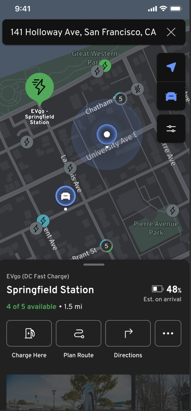

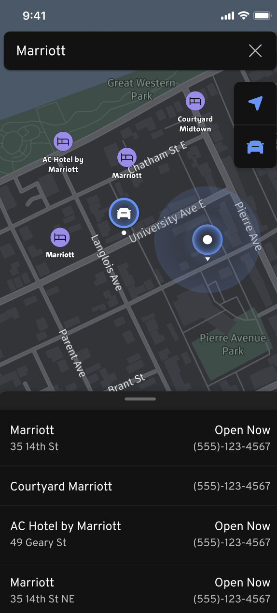

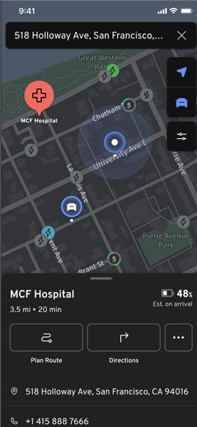

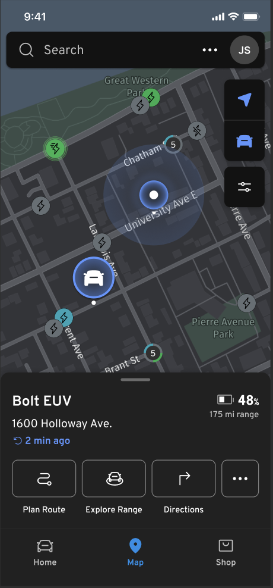
<!-- /generated:media-general-motors-navigation/companion -->

**Responsibilities**

I led the map team of 8 developers (6 React Native, 1 iOS, 1 Android) for a large, complex, high-load app for managing gas and electric cars, built on React Native and the HERE SDK. <!-- src: doc:portfolio-2025-09 --> The team built a reusable map provider module (map display, search, a bottom drawer, markers and charging stations) as a React Native micro-frontend that is integrated into several company products. <!-- src: doc:portfolio-2025-09 --> I coordinated dependencies with the UI team, the backend teams (EV and gas vehicle services, location-based services) and the HERE SDK and HERE API teams: I set scope, deadlines and priorities, led planning, removed blockers, created the integration strategy and set up test automation. <!-- src: doc:portfolio-2025-09 -->

I created and documented the process for delivering and testing our apps inside the parent app (parent app, reusable feature app, map provider app). <!-- src: doc:portfolio-2025-09 --> At the client's request, I changed the architecture to migrate the reusable feature app into the parent app, and planned moving its logic and components to the parent app's patterns (clean architecture, domain-driven design, abstract services, pure components). <!-- src: doc:portfolio-2025-09 --> During the migration, I fixed weak points in the reusable feature's architecture to speed up integration and development: map instances no longer share a global ref, the map provider's global event listener, which caused bugs when several instances were running, became one listener per map, and the map logic moved from the reusable feature into the map provider. <!-- src: doc:portfolio-2025-09 --> I also designed the architecture of a complex search feature reused on different screens, and normalized the state structure that stores markers and search results. <!-- src: doc:portfolio-2025-09 -->

**Technologies and frameworks**

React Native, HERE SDK, HERE API, Redux Toolkit, TypeScript, React Hooks, Git, Azure, Azure Pipelines, Jest, BrowserStack, domain-driven design, clean architecture. <!-- src: doc:portfolio-2025-09 -->

<!-- project: general-motors-navigation/navigation -->

<!-- generated:project-general-motors-navigation/navigation -->
## **Automotive navigation app under NDA for HERE Technologies (React Native, React, Node.js, Android)**
<!-- /generated:project-general-motors-navigation/navigation -->

The customer works in package delivery and builds on HERE solutions (HNod, HNav, HERE SDK, HERE API). <!-- src: doc:portfolio-2025-09 --> We worked on a customizable Android app built with JavaScript tools (Node.js, React Native, React) and Android tools (Kotlin, Java), connected through gRPC. <!-- src: doc:portfolio-2025-09 --> It is a navigation app for large-truck drivers, installed on the driver's tablet and based on HERE maps. <!-- src: doc:portfolio-2025-09 --> Drivers see the route to their destination and set their truck's parameters, such as width and height, to see the restrictions that apply to it. <!-- src: doc:portfolio-2025-09 --> The app can be extended with custom logic and features through service packages connected to the gRPC bundler, which add menu items, screens, pop-ups and routing logic with React Native, React and Node.js. <!-- src: doc:portfolio-2025-09 --> In short, the project consists of the HNod library, service packages and an Android native or web app. <!-- src: doc:portfolio-2025-09 -->

<!-- generated:media-general-motors-navigation/navigation -->
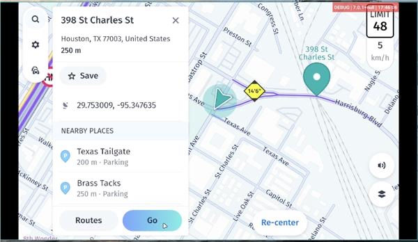

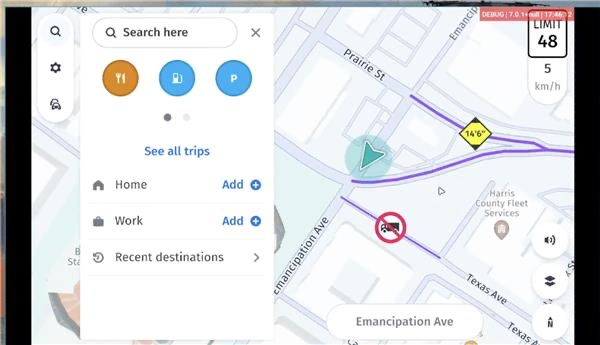
<!-- /generated:media-general-motors-navigation/navigation -->

**Responsibilities**

I was responsible for handling route deviations, when a truck driver leaves the planned route: collecting these cases and sending them to a reporting endpoint. <!-- src: doc:portfolio-2025-09 --> I extended the HERE HNod library to submit route-change events (new route started, previous route restored, route edited, alternative route selected, driver deviated from route, route refreshed, driver parking). <!-- src: doc:portfolio-2025-09 --> I then handled these events, compared the route data to detect deviations, and sent that data to the customer. <!-- src: doc:portfolio-2025-09 -->

**Technologies and frameworks**

JavaScript, TypeScript, Node.js, gRPC, React Native, React, custom HERE solutions (HNod library, HERE bundler, HERE runner, HERE API, HERE SDK, HNav library), RxJS, Jest, GitLab pipelines. <!-- src: doc:portfolio-2025-09 -->

<!-- project: general-motors-navigation/poc -->

<!-- generated:project-general-motors-navigation/poc -->
## **Car navigation PoC under NDA (Node.js, React)**
<!-- /generated:project-general-motors-navigation/poc -->

An automotive app built to show the possibilities of the latest HERE technology in Volkswagen AG cars (Audi, Porsche, Volkswagen and others) and to integrate the latest features: the Hugo AI assistant, L3 interaction, ADAS, Kurviger, ODD, custom themes, layout support and more. <!-- src: doc:portfolio-2025-09 -->

<!-- generated:media-general-motors-navigation/poc -->
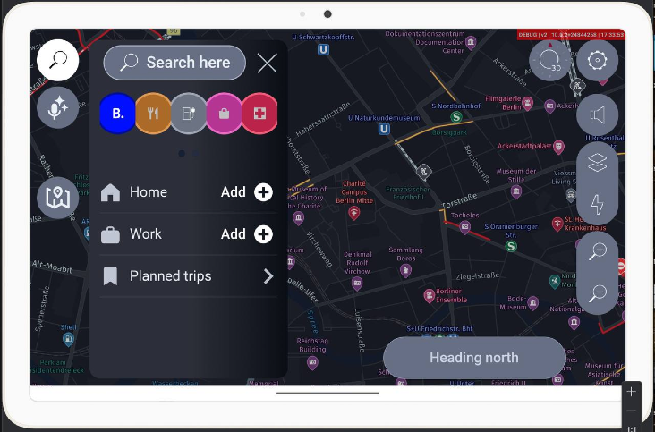
<!-- /generated:media-general-motors-navigation/poc -->

**Responsibilities**

I implemented the L3 interaction feature and the Hugo AI assistant feature, which builds routes and shows nearby places. <!-- src: doc:portfolio-2025-09 --> I also implemented the Porsche theme and layout, and added debug car-data settings for electric cars. <!-- src: doc:portfolio-2025-09 --> I wrote a script that replaced inefficient manual steps and made the build 3x faster. <!-- src: doc:portfolio-2025-09, gm-poc-build-3x -->

**Technologies and frameworks**

JavaScript, Node.js, TypeScript, React, RxJS, gRPC, Kotlin, Java, HNav, HNod, Hugo AI, L3, Kurviger, protobuf.js. <!-- src: doc:portfolio-2025-09 -->

<!-- project: velas-wallet -->

<!-- generated:project-velas-wallet -->
## **Velas Wallet (React, React Native, Electron)**
<!-- /generated:project-velas-wallet -->

A fully open-source, non-custodial, multi-language crypto wallet that supports the Velas, Ethereum, BNB Smart Chain (BSC), Heco and Bitcoin networks. <!-- src: doc:portfolio-2025-09 --> Users can stake VLX and earn rewards, swap tokens between networks through bridges, and send and receive crypto by QR code. <!-- src: doc:portfolio-2025-09 --> The wallet has web, mobile and desktop versions. <!-- src: doc:portfolio-2025-09 -->

<!-- generated:media-velas-wallet -->
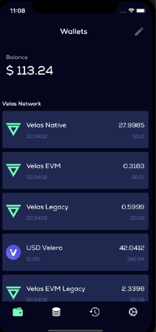

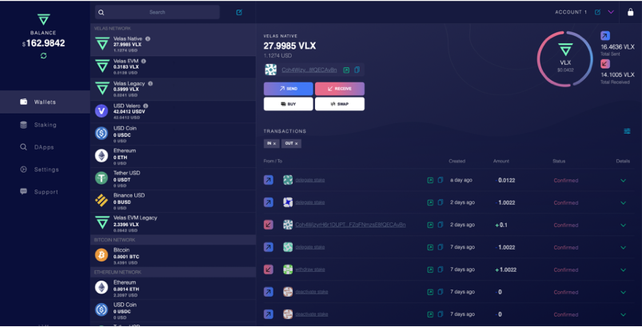
<!-- /generated:media-velas-wallet -->

**Responsibilities**

I removed performance bottlenecks across the wallet: staking page loading went from 2 minutes to 5 seconds, and I eliminated unnecessary component re-renders to make the app faster and easier to use. <!-- src: doc:portfolio-2025-09, velas-wallet#4.2 --> I optimized backend responses for speed by removing unused fields and adding filters and pagination. <!-- src: doc:portfolio-2025-09 --> I configured building and signing of the wallets in CI/CD with GitHub Actions, added end-to-end tests for the mobile wallet with Detox, and published the app to the F-Droid and Snap stores. <!-- src: doc:portfolio-2025-09 --> I also designed the architecture of the new wallet and set up unit tests with Jest. <!-- src: doc:portfolio-2025-09 -->

**Technologies and frameworks**

React Native Web, React Native, Web3, MobX, TypeScript, GitHub Actions, React Hooks, Git, Expo (ejected), React Native CLI, JavaScript, LiveScript, Jest. <!-- src: doc:portfolio-2025-09 -->

<!-- project: designai-jira-plugin -->

<!-- generated:project-designai-jira-plugin -->
## **Jira design generation plugin under NDA (Node.js, React)**
<!-- /generated:project-designai-jira-plugin -->

This generative AI application greatly speeds up designers' work, letting them quickly create MVP, proof-of-concept (PoC) and presales designs for customers. <!-- src: doc:portfolio-2025-09 --> It integrates with the client's Jira board. <!-- src: doc:portfolio-2025-09 --> Users describe their requirements in a text prompt, provide a URL and upload photos or style schemas. <!-- src: doc:portfolio-2025-09 --> The system then generates a design (for example, in Figma format), creates a new Jira ticket with the request and returns the finished design, which streamlines the early design and project-planning phases. <!-- src: doc:portfolio-2025-09 -->

<!-- generated:media-designai-jira-plugin -->

<!-- /generated:media-designai-jira-plugin -->

**Responsibilities**

I built a generative AI Jira plugin with Jira Forge Custom UI, Atlaskit and TypeScript that automates website design generation. <!-- src: doc:portfolio-2025-09 --> A key architectural challenge was working around Jira Forge's strict file upload limits, which I solved by integrating Azure Blob Storage to transfer image data in chunks. <!-- src: doc:portfolio-2025-09 --> The solution works end to end, including calls to the Jira API that automatically create tickets with the generated design and its specifications. <!-- src: doc:portfolio-2025-09 --> Close collaboration with the backend and ML teams brought the project to a successful, on-time delivery. <!-- src: doc:portfolio-2025-09 -->

**Technologies and frameworks**

JavaScript, Node.js, TypeScript, React, Jira, Atlaskit, Forge Custom UI. <!-- src: doc:portfolio-2025-09 -->

<!-- project: orion-mobile-clinical-ink -->

<!-- generated:project-orion-mobile-clinical-ink -->
## **Clinical trial app under NDA (React Native, React, Android)**
<!-- /generated:project-orion-mobile-clinical-ink -->

The app makes it easier to take part in a clinical trial. <!-- src: doc:portfolio-2025-09 --> Depending on the trial, it may provide some or all of the following: help with addresses and directions for upcoming visits; reminders to take medication or complete trial tasks; videos and other content that explain the trial or help participants prepare for upcoming tasks and appointments; and questionnaires about how they are feeling, along with other trial tasks. <!-- src: doc:portfolio-2025-09 -->

<!-- generated:media-orion-mobile-clinical-ink -->
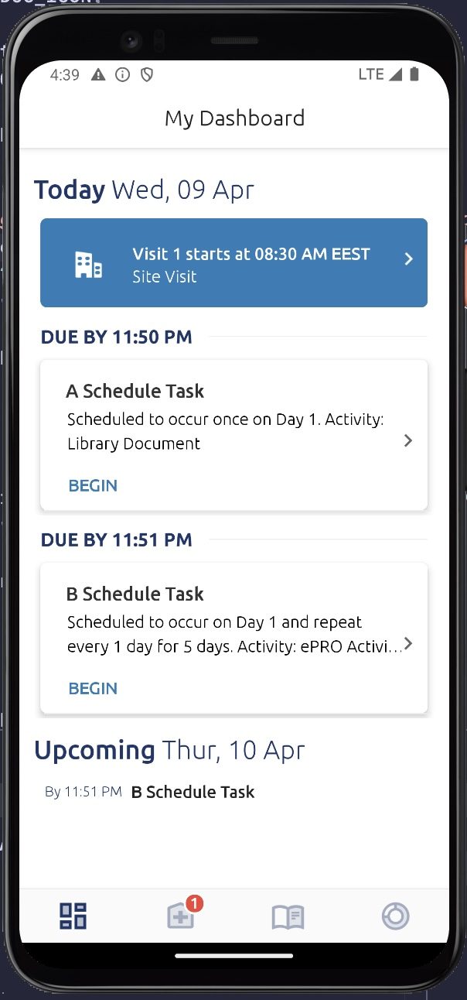

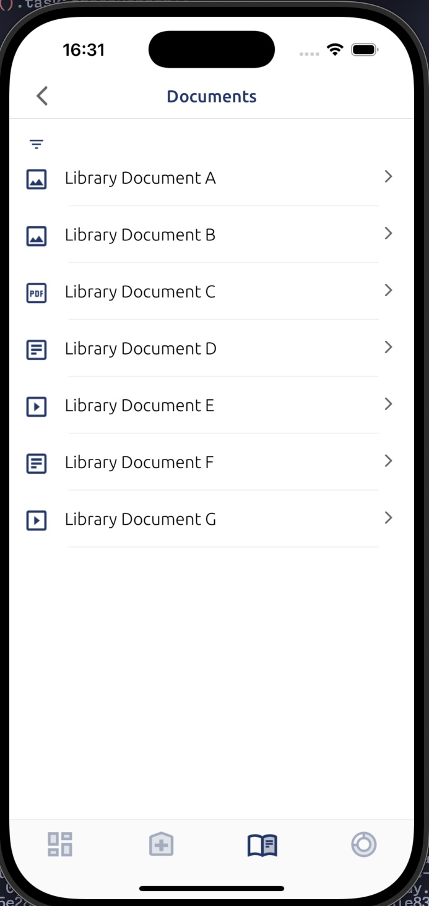

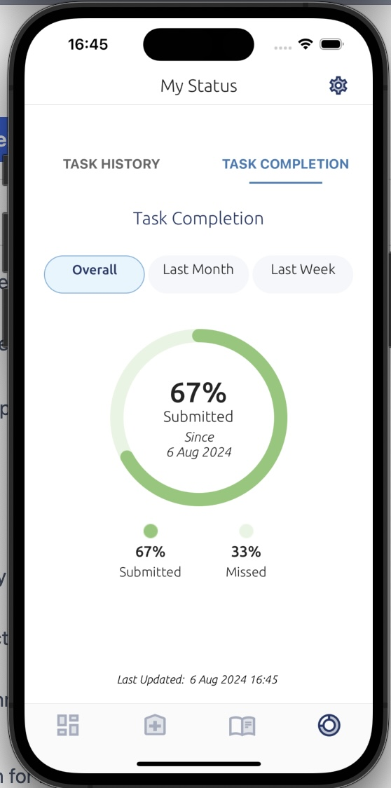
<!-- /generated:media-orion-mobile-clinical-ink -->

**Responsibilities**

I refactored and optimized the app's core flow and integrated it with the patient document library. <!-- src: doc:portfolio-2025-09 --> I raised unit test coverage and applied TypeScript and modern React Hooks best practices to improve maintainability and performance. <!-- src: orion-mobile-clinical-ink#4.2 --> I migrated the Android app from Android 13 to Android 14 to meet Google Play Store requirements, upgraded key dependencies and resolved complex migration issues (for example, the SQLCipher for Android library, SQLite and Android 14 compatibility). <!-- src: doc:portfolio-2025-09 -->

**Technologies and frameworks**

JavaScript, TypeScript, React Native, Expo, React, Kotlin, SQLCipher, Redux Toolkit, AWS SDK (S3), Amazon Cognito, GraphQL, i18next, Apollo, AWS Amplify, Bitbucket Pipelines, Jenkins. <!-- src: doc:portfolio-2025-09 -->

<!-- project: omo-systems-smart-home -->

<!-- generated:project-omo-systems-smart-home -->
## **Smart-home ecosystem IoT device management app for OMO Systems (React Native)**
<!-- /generated:project-omo-systems-smart-home -->

The app provides access control, security and home automation for multi-apartment buildings worldwide. <!-- src: doc:portfolio-2025-09 --> Access to the apartment: residents control and open entrances, doors, barriers, elevators, gates and waste bins from a single app. <!-- src: doc:portfolio-2025-09 --> Video surveillance: they watch buildings and grounds from the same app, with live access to cameras and their video archive, synced with motion sensors through scenarios. <!-- src: doc:portfolio-2025-09 --> Security: the app protects the apartment from burglary and from damage caused by breakdowns and accidents, with traffic monitoring, door and window opening sensors, video surveillance inside the apartment, and automatic gas and water shut-off when a leak occurs. <!-- src: doc:portfolio-2025-09 -->

Residents can also set up scenarios that trigger devices on events, for example starting a camera when a motion sensor detects movement. <!-- src: doc:portfolio-2025-09 --> They manage their home, share it with family members and enable face recognition for their cameras. <!-- src: doc:portfolio-2025-09 --> In security mode the whole home is guarded: if an incident occurs, the app raises an alarm and automatically calls a security team. <!-- src: doc:portfolio-2025-09 -->

<!-- generated:media-omo-systems-smart-home -->

<!-- /generated:media-omo-systems-smart-home -->

**Responsibilities**

I owned the app's key monetization feature, billing by tariff subscription. <!-- src: doc:portfolio-2025-09 --> I designed and built from scratch a React single-page app that handles payments in the app's web view, and added blocking of unpaid devices and features in the app. <!-- src: doc:portfolio-2025-09 --> I implemented biometric login and fixed the react-native-keychain library for face and fingerprint login on Samsung Android devices. <!-- src: doc:portfolio-2025-09, omo-systems-smart-home#4.4 --> I fixed video stream issues in the react-native-vlcplayer library with patches, and was the tech lead of the frontend team for a sprint. <!-- src: doc:portfolio-2025-09 -->

**Technologies and frameworks**

React Native, TypeScript, React Navigation, React Native Navigation, React Hooks, Git, React Redux, Reselect, Redux Saga, Fastlane, react-native-vlcplayer, react-native-keychain, react-native-aws-cognito-js, react-native-webview, react-native-nfc-hce. <!-- src: doc:portfolio-2025-09 -->

<!-- project: thermo-fisher-dosimeter -->

<!-- generated:project-thermo-fisher-dosimeter -->
## **IoT app with dosimeter under NDA (React Native)**
<!-- /generated:project-thermo-fisher-dosimeter -->

The app helps doctors around the world who work with radiation avoid overexposure. <!-- src: doc:portfolio-2025-09 --> It has three roles (user, admin and superuser), OAuth 2.0 login, 10 screens, and REST API, MQTT and Bluetooth communication. <!-- src: doc:portfolio-2025-09, dosimeter-10-screens --> The app reads data from radiation dosimeters over Bluetooth, sends it to an IoT server over MQTT, and can sync many dosimeters at the same time. <!-- src: doc:portfolio-2025-09 --> A main menu with swipe navigation and bottom pagination leads to the main screen, which shows sync progress, how many dosimeters synced with errors, and the sync time. <!-- src: doc:portfolio-2025-09 --> Another screen shows the details of the current sync, or of the last one when no sync is running, and the last screen holds the history of all syncs, filterable in a full-screen modal by date range, wearer, errors and ID. <!-- src: doc:portfolio-2025-09 --> The history is stored in a local Realm database, and all secure values in the keychain. <!-- src: doc:portfolio-2025-09 --> The app can also update the dosimeter firmware, and menus on the left and right lead to the Profile, Settings and Logs pages (Logs for superusers only). <!-- src: doc:portfolio-2025-09 -->

<!-- generated:media-thermo-fisher-dosimeter -->

<!-- /generated:media-thermo-fisher-dosimeter -->

**Responsibilities**

I built the API communication logic between the backend and the UI screens, and investigated, fixed and rewrote React Native and native libraries so they worked properly for our needs. <!-- src: doc:portfolio-2025-09 --> I took an active part in project meetings, proposed effective solutions for the business, did code reviews, covered code with unit tests following a TDD approach, and suggested ways to improve the user experience. <!-- src: doc:portfolio-2025-09 --> I integrated MQTT, built the OAuth 2.0 login flow, worked with background jobs on Android and iOS, and added native modules. <!-- src: doc:portfolio-2025-09 --> I also improved the dosimeter data parsing so data is no longer overwritten, and set up the Realm database connection with its filter logic. <!-- src: doc:portfolio-2025-09 -->

**Technologies and frameworks**

React Native, TypeScript, React Navigation, React Hooks, Git, Fastlane, react-native-ble-plx, Jira, react-native-app-auth, Formik, AsyncStorage, Redux Saga, react-native-fs, react-native-keychain, react-native-native-mqtt, Realm, ESLint, Husky. <!-- src: doc:portfolio-2025-09 -->

<!-- project: itjet-fintech/aspiration-signup -->

<!-- generated:project-itjet-fintech/aspiration-signup -->
## **Aspiration signup (React Native Web)**
<!-- /generated:project-itjet-fintech/aspiration-signup -->

Aspiration is a large company that develops a banking app ecosystem for customers in the US. <!-- src: doc:portfolio-2025-09 --> It is an eco-friendly bank that helps the planet by planting trees and investing in renewable energy sources and fossil fuel. <!-- src: doc:portfolio-2025-09 --> The company moved its signup flow from Angular to React. <!-- src: doc:portfolio-2025-09 -->

<!-- generated:media-itjet-fintech/aspiration-signup -->
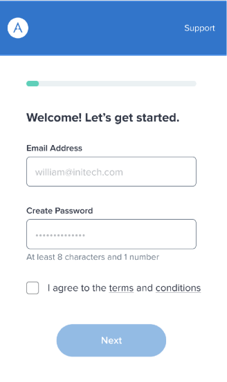

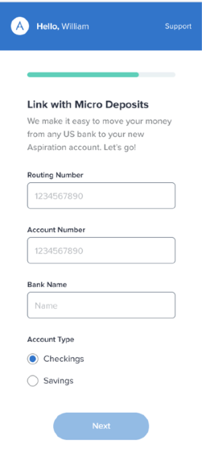

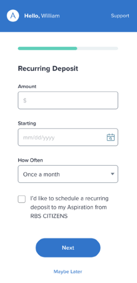
<!-- /generated:media-itjet-fintech/aspiration-signup -->

**Responsibilities**

I fixed and refactored the existing signup flow, added new screens and components, and helped native mobile developers integrate React Native into the native apps. <!-- src: doc:portfolio-2025-09 --> I worked with the US developers and product managers, took an active part in project meetings, proposed effective solutions for the business and did code reviews. <!-- src: doc:portfolio-2025-09 --> I added the API connection logic, covered code with unit tests, created an end-to-end test utility and applied component-driven development (CDD) across the project. <!-- src: doc:portfolio-2025-09 --> I integrated Plaid, Google Places and reCAPTCHA v3, linked React Native libraries manually, wrote a pull request style guide and documentation for easier onboarding, added A/B tests and suggested ways to improve the user experience. <!-- src: doc:portfolio-2025-09 -->

**Technologies and frameworks**

React Native Web, Apollo GraphQL, TypeScript, React Navigation, React Hooks, Git, CircleCI, Plaid, Cucumber, Puppeteer, Jest, PlanOut, Segment, Rollbar, Crashlytics, scaffolding, CDD, DDD, Next.js, Storybook, ESLint, CSS Grid, Jira. <!-- src: doc:portfolio-2025-09 -->

<!-- project: itjet-fintech/aspiration-web -->

<!-- generated:project-itjet-fintech/aspiration-web -->
## **Aspiration banking web app (React)**
<!-- /generated:project-itjet-fintech/aspiration-web -->

A banking web app flow for planting trees from your transactions and for changing your profile, settings and more. <!-- src: doc:portfolio-2025-09 -->

<!-- generated:media-itjet-fintech/aspiration-web -->
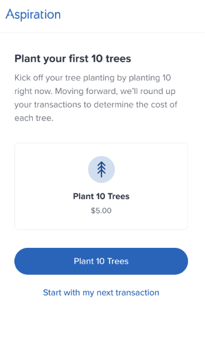

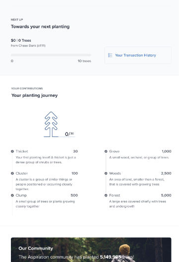

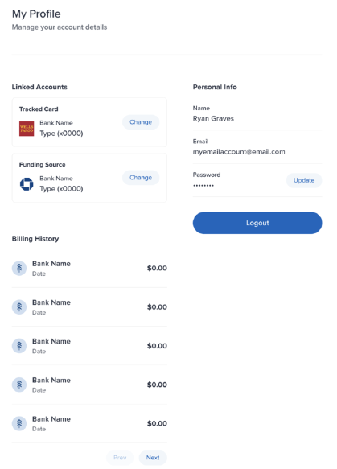
<!-- /generated:media-itjet-fintech/aspiration-web -->

**Responsibilities**

I built the application from scratch based on the designs, with a mobile-first approach and reusable components following Atomic Design, and added a scaffolding generator for the file structure. <!-- src: doc:portfolio-2025-09 --> I worked with the remote team in the US, took an active part in grooming sessions and retrospectives, solved communication problems between the remote teams, and planned the scope of tasks for the next period. <!-- src: doc:portfolio-2025-09 -->

**Technologies and frameworks**

React, Apollo GraphQL, React Hooks, Git, Plaid, Jest, Next.js, Storybook, ESLint, CSS Grid, Atomic Design, CDD, UI patterns, Jira, styled-components, Plop. <!-- src: doc:portfolio-2025-09 -->

<!-- project: itjet-fintech/registart -->

<!-- generated:project-itjet-fintech/registart -->
## **RegiStart (React web, Node.js backend, CI/CD)**
<!-- /generated:project-itjet-fintech/registart -->

RegiStart is a nonprofit startup that uses social networks and technology to systematically increase voter registration among 18-year-olds. <!-- src: doc:portfolio-2025-09 --> The app's main goal is to raise voter registration rates in schools that use RegiStart by distributing seniors among student organizers, who motivate them to vote. <!-- src: doc:portfolio-2025-09 --> Its slogan is "Strengthening America by registering voters, educating students on citizenship, and shaping students into citizens." <!-- src: doc:portfolio-2025-09 -->

<!-- generated:media-itjet-fintech/registart -->
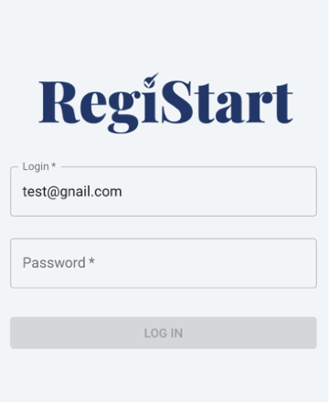

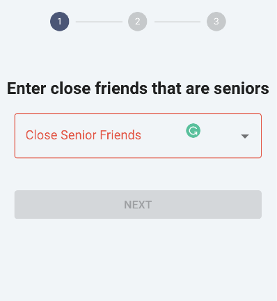

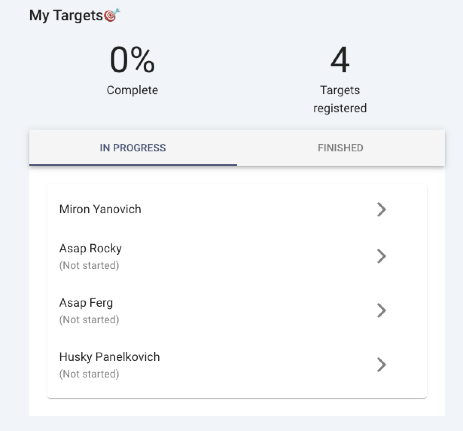

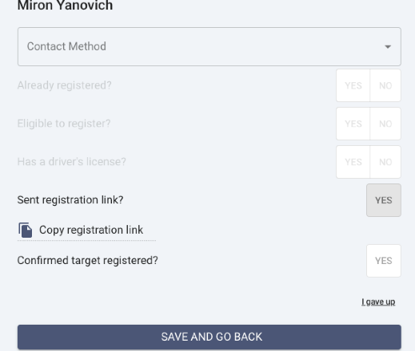
<!-- /generated:media-itjet-fintech/registart -->

**Responsibilities**

I developed the MVP of the frontend from scratch based on sketches with React and Material UI, planned the database tables and relationships, and built the Node.js backend, connected to the database with Sequelize. <!-- src: doc:portfolio-2025-09 --> I set up the PostgreSQL database on AWS RDS, configured CI/CD for deployment to AWS EC2 and S3, added database migrations with node-pg-migrate, and created an optimized algorithm that distributes students among organizers. <!-- src: doc:portfolio-2025-09 -->

**Technologies and frameworks**

React, Redux, TypeScript, AWS (EC2, S3, RDS), CI/CD with Bitbucket Pipelines, PostgreSQL, Sequelize, node-pg-migrate, Formik, Material UI, Nginx, PM2, Jira. <!-- src: doc:portfolio-2025-09 -->

<!-- project: itjet-fintech/fused -->

<!-- generated:project-itjet-fintech/fused -->
## **Fused (web, mobile and backend)**
<!-- /generated:project-itjet-fintech/fused -->

The application has two roles, coach and athlete, and users can switch roles on the settings screen. <!-- src: doc:portfolio-2025-09 --> Coaches invite athletes, create workouts and exercises for them, build teams from athletes and track their workout progress. <!-- src: doc:portfolio-2025-09 --> To create a subscription, a coach adds card details and a bank account. <!-- src: doc:portfolio-2025-09 --> The app was published on Google Play. <!-- src: doc:portfolio-2025-09 -->

<!-- generated:media-itjet-fintech/fused -->
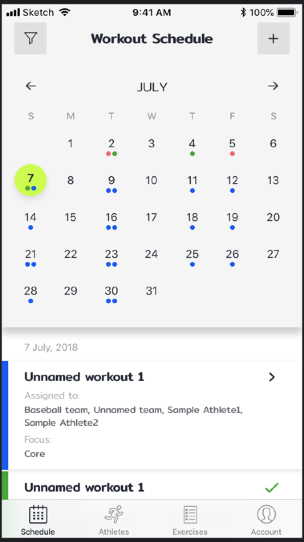

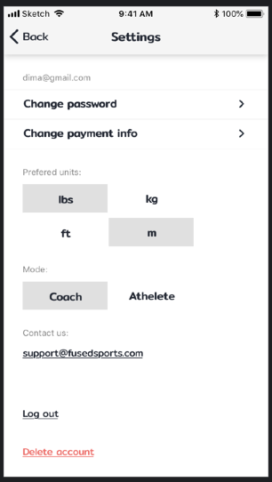

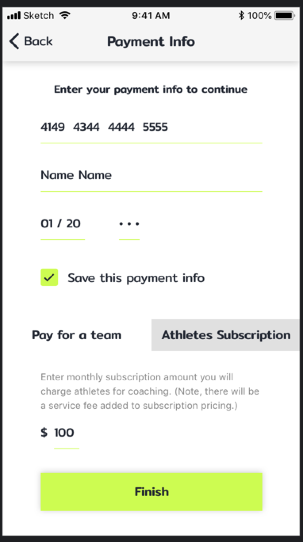

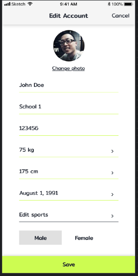

<!-- /generated:media-itjet-fintech/fused -->

**Responsibilities**

I added new features and worked with the API: I built the athlete flow in the web version (previously coach-only), moved all payment logic from the mobile app to the web version, added backend endpoints for removing cards, made the web version fully responsive, and fixed existing bugs in the mobile app. <!-- src: doc:portfolio-2025-09 --> On the web and backend side, I migrated the dev and production databases to AWS RDS, fully configured the CI/CD process and created the dev backend EC2 instance. <!-- src: doc:portfolio-2025-09 --> I also wrote documentation and communicated directly with the client. <!-- src: doc:portfolio-2025-09 -->

**Technologies and frameworks**

React Native, React, React Router, React Navigation, Node.js, Sequelize, PostgreSQL, React Hooks, Redux, RxJS, Stripe, Docker, AWS, Bugsnag, Bitbucket Pipelines, Fastlane, Git, Nginx, PM2, Jira. <!-- src: doc:portfolio-2025-09 -->

<!-- project: itjet-fintech/wink -->

<!-- generated:project-itjet-fintech/wink -->
## **Wink (React Native)**
<!-- /generated:project-itjet-fintech/wink -->

Users like or dislike other users by swiping right or left for gems (the in-game currency), get notifications when someone likes them, and change their profile settings. <!-- src: doc:portfolio-2025-09 --> They earn gems through actions such as sharing the app link with friends, claiming a daily prize and leaving a review on Google Play. <!-- src: doc:portfolio-2025-09 --> The app was published on Google Play and the App Store and reached more than 5 million registered users. <!-- src: doc:portfolio-2025-09, itjet-fintech#4.8 -->

<!-- generated:media-itjet-fintech/wink -->
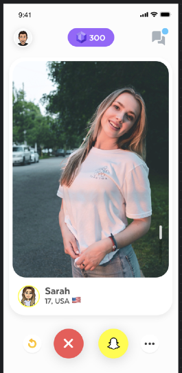

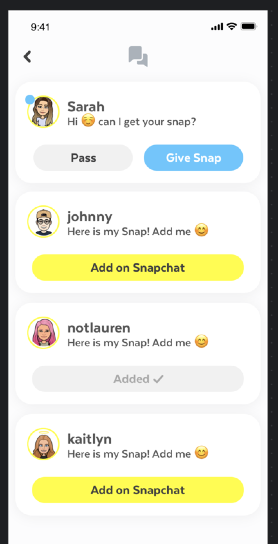

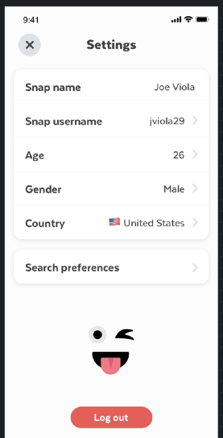

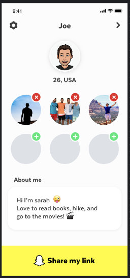
<!-- /generated:media-itjet-fintech/wink -->

**Responsibilities**

I developed the app from scratch based on the designs, with login through Snapchat or a mobile number, integration with the backend API, and push notifications. <!-- src: doc:portfolio-2025-09 --> I optimized and tested the app, configured CI/CD for deployment, added image optimization on the Node.js backend, did code reviews and communicated directly with the customer. <!-- src: doc:portfolio-2025-09 -->

**Technologies and frameworks**

React Native, TypeScript, React Hooks, React Navigation, Redux, Redux Thunk, Firebase, Bugsnag, Fastlane, Bitrise, AWS, Node.js, Git, CSS Grid, Flexbox, Jira. <!-- src: doc:portfolio-2025-09 -->

<!-- project: itjet-fintech/golfuture -->

<!-- generated:project-itjet-fintech/golfuture -->
## **Golfuture (React Native)**
<!-- /generated:project-itjet-fintech/golfuture -->

Golfuture is a proprietary new concept of golf that lets players enjoy many of the best elements of traditional golf in a more time-efficient, eco-friendly and affordable way. <!-- src: doc:portfolio-2025-09 --> Players use the smartphone app to choose a course and their playing partners, and the app guides them through the facility at their own pace, with no waiting for others. <!-- src: doc:portfolio-2025-09 --> Golfuture combines innovative course design with modern ball-tracking technology to create an exciting environment for golfers. <!-- src: doc:portfolio-2025-09 --> The app was published on Google Play and the App Store. <!-- src: doc:portfolio-2025-09 -->

<!-- generated:media-itjet-fintech/golfuture -->
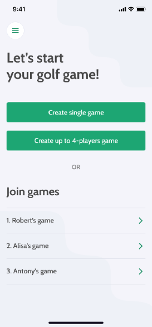

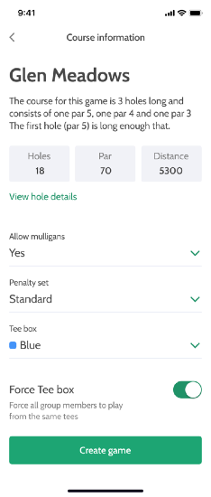

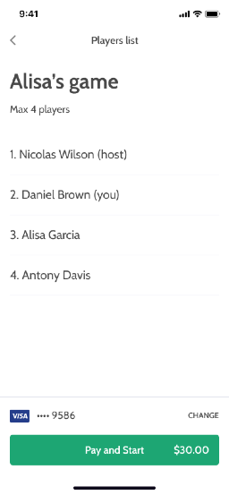

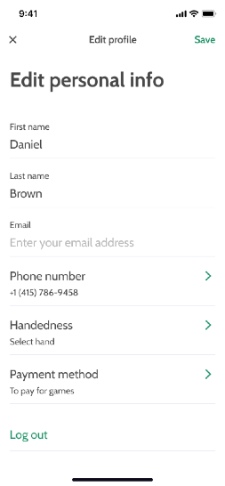
<!-- /generated:media-itjet-fintech/golfuture -->

**Responsibilities**

I developed the app from scratch based on the designs: I planned and built the components and pages, added the business logic, and connected Stripe and other APIs. <!-- src: doc:portfolio-2025-09 --> I optimized and tested the app, took an active part in project meetings and planning, and presented the results directly to the customer. <!-- src: doc:portfolio-2025-09 -->

**Technologies and frameworks**

React Native, Redux, TypeScript, Redux Thunk, React Navigation, Fastlane, Bugsnag, React Hooks, Stripe, Bitrise, Git, CSS Grid, Jira. <!-- src: doc:portfolio-2025-09 -->

<!-- project: itjet-fintech/oroscopo -->

<!-- generated:project-itjet-fintech/oroscopo -->
## **Oroscopo (React Native)**
<!-- /generated:project-itjet-fintech/oroscopo -->

Oroscopo is a tarot and astrology mobile app that makes predictions for zodiac signs, lays out different tarot spreads for the future, and calculates the compatibility between signs. <!-- src: doc:portfolio-2025-09 --> The app was published on Google Play and the App Store. <!-- src: doc:portfolio-2025-09 -->

<!-- generated:media-itjet-fintech/oroscopo -->
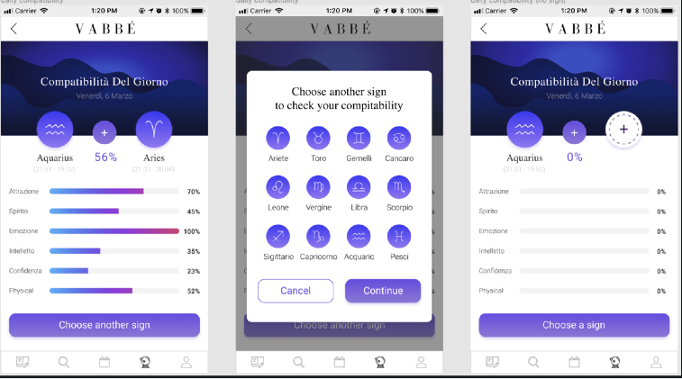

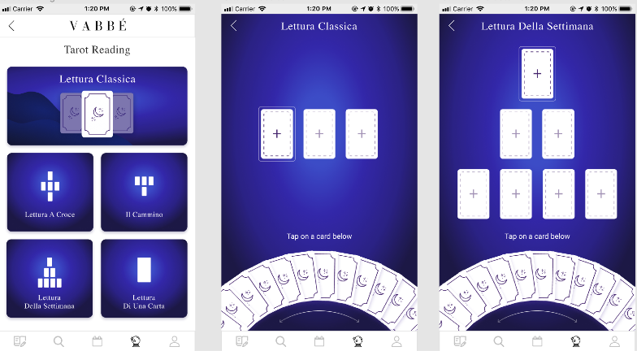
<!-- /generated:media-itjet-fintech/oroscopo -->

**Responsibilities**

I added new features and worked with the app's API: UI components, an animated card circle, the zodiac compatibility logic, banner ads and new screens with tarot layouts. <!-- src: doc:portfolio-2025-09 --> I optimized and tested the app, took an active part in project meetings, and presented the results directly to the customer. <!-- src: doc:portfolio-2025-09 -->

**Technologies and frameworks**

React Native, Redux, TypeScript, Redux Thunk, React Navigation, React Hooks, Git, Firebase, AdMob, Jira. <!-- src: doc:portfolio-2025-09 -->
